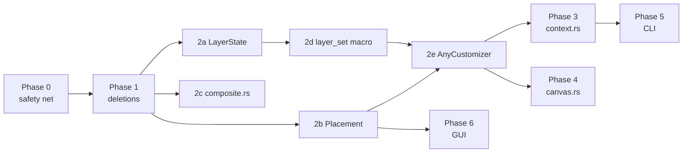

# Folco refactor plan (pre-1.0)

Audit date: 2026-10-18. Scope: all workspace crates + `gui/src` (excluding vendored
`gui/src/lib/components/ui`). ~14 kLOC total. Every finding below was verified against
source; line numbers are as of this commit.

## 0. Honest assessment

This codebase is in better shape than "LLM-generated" usually implies. Error types are
specific, platform code is isolated behind three `cfg` lines in `sys/mod.rs`, the profile
is medium-neutral by design, `capabilities.rs` is a single source of truth with an
invariant test, and the renderer has ~130 unit tests including pixel-sampling tests.
Do not rewrite anything.

The real problems are narrower than "large files":

| # | Problem | Evidence | Cost today |
|---|---------|----------|------------|
| 1 | **The same 4-way customizer dispatch is hand-written in two crates.** `FolderIconCustomizer` / `SvgFolderIconCustomizer` / `CustomIconCustomizer` / `SvgCustomIconCustomizer` have no common trait, so every caller matches on an enum. | `crates/folco-renderer-wasm/src/canvas.rs` `ActiveCustomizer` — 45 match arms across ~15 methods. `crates/folco-core/src/context.rs` `FolderStrategy` — 20 match arms across 10 methods. | Adding one layer or one method touches 2 crates × N match sites. This is the #1 source of the "big file" feeling in both `canvas.rs` (736) and `context.rs` (925). |
| 2 | **Dead public API in `folco-core`.** Sync variants kept alongside async; "live preview" accessors never wired up. | `context.rs`: `customize_folders` (438), `reset_folders` (474), `customize_folder` (488), `reset_folder` (502), `customizer` (347), `customizer_mut` (358), `customize_folders_custom` (704), `export_profile` (417), `cache`/`cache_mut` (366/371), `refresh_cache` (582), `output_medium` (641). Zero external callers for all of these. | ~150 lines + doc comments that describe an API nobody uses; readers assume the sync path matters. |
| 3 | **Two parallel layer skeletons.** `Layer<C>` and `SvgLayer<C>` are byte-for-byte identical except for a cache field. | `layer/mod.rs:225-300` vs `svg_layer/mod.rs:22-88`. | Every change to `set_config` semantics (versioning, dirty-tracking) must be made twice. |
| 4 | **Placement is a concept without a type.** `position + anchor_mode + scale` is inlined into two configs with identical `differs_from` / `with_placement`; the math is written twice in two coordinate systems. | `layer/color_dot.rs:99-125`, `layer/overlay.rs:160-170`; math at `layer/overlay.rs:224` (`calculate_position`, pixels) and `svg_layer/overlay.rs:61-95` (`placement`, percent). Meanwhile `placement.rs` has a `Placement {position, scale}` that lacks `anchor_mode`. | Raster and SVG badges can drift apart silently. |
| 5 | **Three copy-pasted progress loops in the CLI.** | `crates/folco-cli/src/main.rs:473-521`, `549-596`, `622-653`. ~130 lines, differ only in one message string and one omitted arm. | Zero tests cover them. |
| 6 | **Cache-invalidation bookkeeping is manual.** Each `LayerSet` lists its layers 3× (`versions()`, `execute()`, `invalidate_all()`), and `FolderLayers::versions()` lists them in a *different* order than `execute()`. | `folder_customizer.rs:68-75` vs `:59-75`. | Works today only because FNV is order-sensitive and nobody re-ordered one without the other. Classic "forgot to add the new layer to one of the three lists" bug waiting to happen. |
| 7 | **No tests where behaviour is most likely to regress.** | `folco-cli`: 0 tests. GUI: no test runner configured. `context.rs` async paths + `render_and_write`: 0 tests. | Refactors in phases 3-6 cannot be verified mechanically. |
| 8 | **Misplaced helpers.** Generic raster compositing lives in an SVG module and is imported from there by the customizers. | `layer/svg.rs:343 composite_over`, `alpha_blend`; imported in `folder_customizer.rs:36`. `layer/svg.rs` (543 lines) = SvgSource + resvg + pixel compositing + 180 lines of tests. | Readers look for `composite_over` in the wrong place. |

Things the audit flagged that I **disagree** with and will not do:

- Splitting `capabilities.rs` or `profile.rs`. They are long because they are exhaustive, and both have tests that enforce their invariants. Leave them.
- Splitting `renderer.svelte.ts` into three stores. It is a thin facade; the 380 lines are mostly a repeated 3-line wrapper (fixed in Phase 6 by one helper) and doc comments. The "star topology" of `folder-operations` is just the orchestrator doing its job.
- Deleting `casing.ts`. It is imported by the vendored `ui/emoji-picker/emoji-picker-list.svelte`. Not our code; leave it.
- Per-pixel micro-optimisations in `composite_over` / `apply_solid_color`. No measured problem.

## 1. Ground rules

From the repo's `refactor` skill, applied strictly:

1. **No behaviour change.** A phase is done when the pixel-sampling tests, `cargo test --workspace`, and a manual GUI smoke pass are green and the output SVG/PNG for a fixed profile is byte-identical before/after (see §2).
2. **One commit per bullet.** Each bullet below is sized to be a single reviewable commit that leaves `main` green.
3. **Tests first for any phase touching untested code** (3, 5, 6).
4. **Do not mix with features.** The SVG-decal TODO in repo memory stays out of scope.
5. Delete before you abstract. Phase 1 shrinks the surface so Phase 2 has less to unify.

## 2. Phase 0 — Safety net

Goal: make the later phases mechanically verifiable. No production code changes.

- [ ] ~~**Golden-output fixture.**~~ Skipped (2026-10-29): app is unreleased, so byte-identical output across phases isn't worth pinning yet.
- [x] **Customizer conformance test.** `crates/folco-renderer/tests/conformance.rs`: for every customizer, `apply_profile(p); assert_eq!(export_profile(), p minus rejected layers)` where "rejected" comes from `IconBaseKind::rejection()`, plus "empty profile clears everything". This pins the contract the Phase 2 trait must preserve.
- [ ] ~~**`render_and_write` sequence test.**~~ Skipped: icon-sys already has integration tests covering this path.
- [x] **GUI test runner.** Bun's built-in runner, not vitest. `gui/bunfig.toml` preloads `gui/tests/preload.ts`, a Bun plugin that compiles `.svelte` / `.svelte.ts` through `svelte/compiler` so rune stores import cleanly; `$lib` resolves via tsconfig paths. `bun test` script + `@types/bun`. No tests written yet — decide what to cover later.
- [ ] ~~**CLI smoke.**~~ Skipped as overkill.

## 3. Phase 1 — Deletions (zero-risk, do first)

Each bullet: delete, `cargo check --workspace`, commit.

- [x] `context.rs`: remove `customize_folders` (sync), `reset_folders` (sync), `customize_folder`, `reset_folder`, `customize_folders_custom` (sync). Update the two doc-comment examples in `context.rs:325-335` and `lib.rs:28-31` to the async forms. The GUI already `block_on`s the async versions (`state.rs:143,156`), so there is no sync consumer.
- [x] `context.rs`: remove `customizer()`, `customizer_mut()`, context-level `export_profile()`. (`FolderStrategy::export_profile` went with it — no remaining callers.)
- [x] `context.rs`: remove `cache()`, `cache_mut()`, `refresh_cache()`, `output_medium()` — verified by grep. The `cache` field went too; `build()` only needs the `IconCache` long enough to load the icon set.
- [x] `medium.rs`: delete the `Medium` trait, `RasterMedium`, `SvgMedium`. Keep `SvgCanvas`.
- [x] `layer/mod.rs`: delete the stale `NOTE` about `LayerPipeline`.
- [x] `gui/src/lib/components/app/splash-overlay/`: empty directory, deleted.
- [x] `gui/src-tauri/src/lib.rs`: delete the commented-out devtools block.
- [x] `folco-core`: `custom_image_medium()`. **Chose neither option as written.** Routing didn't fit: the CLI checks before it has a context (and needs `caps.custom_image_extensions()` for its error message), and the GUI's `load_custom_image` only has a path/format — no `ImageSource`, and it deliberately doesn't read the file first. The decision is platform-static, so `WriteCapabilities::current_platform().custom_image_medium(format)` *is* the right single entry point for callers. Made the context method private (it's still used by `customize_folders_with_image_async`), which removes the duplicate public surface.
- [x] (Unplanned, pre-existing) Three renderer doc tests called the private `render_all()` and had been failing. Switched the examples to `Render::render_full_output()`. Needed to make `cargo test --workspace` a usable gate.

Result: `context.rs` 925 → 732 lines, `medium.rs` 168 → 109. No behaviour change.

## 4. Phase 2 — `folco-renderer`: one contract for all customizers

This phase is the lever for everything downstream. Order matters; each step is independently shippable.

### 2a. Extract `LayerState<C>` (dedupe `Layer` / `SvgLayer`) — done 2026-10-31

- [x] New `layer/state.rs`: `pub struct LayerState<C> { config: Option<C>, version: u64 }` with `config()`, `is_active()`, `version()`, `set_config() -> bool`, `invalidate()`. `SvgLayer::apply()` was **not** carried over — it was a zero-caller alias for `set_config`. Three unit tests pin the version-bump semantics.
- [x] `Layer<C>` is now `{ state: LayerState<C>, cache: HashMap<..> }`; `set_config`/`invalidate` delegate and clear the cache. `SvgLayer<C>` is `pub type SvgLayer<C> = LayerState<C>;` — the `render_fragment` inherent impls on `SvgLayer<ColorDotConfig>` / `SvgLayer<ImageOverlayConfig>` resolve through the alias unchanged.
- [x] Deleted the duplicate skeleton from `svg_layer/mod.rs`.

### 2b. Introduce a real `Placement` value type — done 2026-10-31

**Wire-format decision (user's call):** `placement` is a **nested object**, not flattened. `#[serde(flatten)]` would have kept the old flat JSON but serde ignores `#[serde(default)]` on flattened fields (serde#1626), so one shared `Placement` couldn't be lenient for the dot (rgb-only JSON) and strict for the overlay. Nested keeps both behaviours and the app is unreleased, so no saved profiles break.

- [x] `placement.rs::Placement` is `{ position, anchor_mode (serde default), scale }` with `new()` (clamps scale), `differs_from()` (the ε-compare, written once), and `Serialize`/`Deserialize`/`JsonSchema`/`Tsify`. `OverlayAnchorMode` gained `Tsify` so the generated d.ts is self-contained.
- [x] `ColorDotConfig { r, g, b, placement }` (defaults to `DEFAULT_COLOR_DOT_PLACEMENT`, so rgb-only JSON still works) and `ImageOverlayConfig { source, placement }`. Both `differs_from` delegate. All constructors take a `Placement`; the two 3-arg `with_placement`/`new` copies are gone.
- [x] `DefaultPlacements::{RASTER,VECTOR}` carry `anchor_mode: Inset`. GUI only reads `position`/`scale` off `defaultPlacements()`; confirmed additive, `bun run check` clean after regenerating the wasm pkg.
- [x] **Math unified — but not via `unit_rect`.** A 0..1 rect can't reproduce the raster output byte-for-byte: raster floors the overlay size first (`(min_dim * scale) as u32`) and halves by integer division, so `bx + x_unit * bw` drifts by a pixel. Instead `Placement::origin<T: PlacementScalar>(total_w, total_h, w, h)` holds the single 9-arm rule table generically; `i32` halves by integer division (pixels), `f32` by `/2.0` (percent). `layer/overlay.rs::pixel_position` and `svg_layer/overlay.rs::percent_rect` are 3-line wrappers. `calculate_position` is deleted, but kept verbatim as a **test oracle** in `placement.rs` — `raster_origin_matches_legacy_formula_for_every_combination` runs all 10 `(position, anchor)` combinations × 4 geometries (odd sizes, offset non-square bounds) and asserts pixel equality. The `*_rasterizes_into_bottom_right` tests still pass.

### 2c. Move compositing out of `layer/svg.rs` — done 2026-10-31

- [x] ~~New `layer/composite.rs`~~ **Replaced with library calls instead** (user's call, after review). The hand-rolled `composite_over`/`alpha_blend` were a reimplementation of `image::imageops::overlay` (same source-over semantics, same clipping incl. negative offsets); `pixmap_to_rgba_image`/`unpremultiply` reimplemented `tiny_skia::PremultipliedColorU8::demultiply()`. All seven call sites now call `imageops::overlay` directly; `pixmap_to_rgba_image` is a 10-line `demultiply` + `from_raw` in `svg.rs`. ~120 lines deleted.
- **Known numeric deviation** (accepted): `image`'s `Rgba::blend` truncates the blended channel to `u8` where ours rounded, so anti-aliased edge pixels can differ by 1 LSB; it also leaves a fully-transparent destination pixel untouched where ours zeroed it. `demultiply()` rounds in `f64` where ours used `f32` — differs only at exact `.5` ties. All pixel-sampling tests still pass.

### 2d. Declarative layer-set bookkeeping — done 2026-10-31

- [x] `layer_set_versions!(a, b, ...)` in `customizer.rs`, `pub(crate) use`d. It expands to the `combined_version` / `invalidate_all` **trait methods directly inside the `impl LayerSet for` / `impl SvgLayerSet for` block** (both traits share those method names), so there's no inherent `versions()` helper — one list per layer set, period. All four sets use it in execution order; `FolderLayers` is now `solid_color, decal, color_dot, overlay`, fixing the ordering mismatch. `FolderLayers::versions()` deleted.
- [x] `every_layer_changes_combined_version` test in each of the four layer-set files. Mutation-checked: removing `decal` from the `FolderLayers` list makes exactly that test fail.

### 2e. The `AnyCustomizer` trait (the big one)

Object-safe trait implemented by all four concrete customizers, so `folco-core` and the WASM crate hold `Box<dyn AnyCustomizer>` and stop matching.

- [ ] Define in a new `customizer_api.rs` (name is a suggestion):
  ```rust
  pub enum RenderedOutput { Raster(IconSet), Vector(String) }

  pub enum LayerIntent {
      SolidColor(Option<SolidColorConfig>),
      Decal(Option<DecalConfig>),
      ColorDot(Option<ColorDotConfig>),
      Overlay(Option<ImageOverlayConfig>),
  }

  pub trait AnyCustomizer {
      fn base_kind(&self) -> IconBaseKind;
      /// Returns false if this base cannot realize the layer (see IconBaseKind::rejection).
      fn set_layer(&mut self, intent: LayerIntent) -> bool;
      fn apply_profile(&mut self, profile: CustomizationProfile);   // wire type; impl converts to Folder/CustomProfile
      fn export_profile(&self) -> CustomizationProfile;
      fn render_preview(&mut self, size: u32) -> Result<IconImage, RenderError>;
      fn render_output(&mut self) -> Result<RenderedOutput, RenderError>;
      fn clear_layers(&mut self);
      fn clear_cache(&mut self);
      /// Raster bases expose their size ladder; vector bases return None.
      fn base_icons(&self) -> Option<&IconSet>;
      fn base_svg(&self) -> Option<&str>;
  }
  ```
  `IconCapabilities`, `LayerRejections`, `DefaultPlacements` are all derivable from `base_kind()`, so they are provided methods, not required ones.
- [ ] Implement for `IconCustomizer<FolderLayers>`, `IconCustomizer<CustomLayers>`, `SvgIconCustomizer<SvgFolderLayers>`, `SvgIconCustomizer<SvgCustomLayers>`. Most bodies already exist as inherent methods; this is mostly moving code under `impl AnyCustomizer for`.
- [ ] Run the Phase 0 conformance test against `Box<dyn AnyCustomizer>` for all four. Green = contract preserved.
- [ ] Decide what to do with the existing `Render` trait (`output.rs`) and its associated `Output` type. It is what makes the customizers non-object-safe today. Once `AnyCustomizer` exists, `Render` can be deleted or demoted to `pub(crate)`.

After 2e the renderer's public surface is: four constructors, one trait, the config types, the profile types. That is the API the next two phases consume.

## 5. Phase 3 — `folco-core`: shrink `context.rs` around the trait

- [ ] Replace `FolderStrategy` with `strategy: Box<dyn AnyCustomizer>`. All ten `match self.strategy` blocks (`context.rs:235-300, 641`) become one-liners. `from_sys_icon_set` is the only place that still branches (on `SysIconSet.svg.is_some()`), which is correct — that's the platform decision.
- [ ] `folder_icon_base()` / `folder_icon_svg()` become `strategy.base_icons()` / `strategy.base_svg()` — the Tauri DTO layer already handles the Option.
- [ ] Split the file by responsibility (after the above, each part is small enough to be obvious):
  - `context/mod.rs` — `CustomizationContext` struct, `AppInfo`, Debug impl.
  - `context/builder.rs` — `CustomizationContextBuilder` (`:85-160`).
  - `context/operations.rs` — `customize_folders_async`, `reset_folders_async`, `customize_folders_with_image_async`, `render_and_write`, `FolderIconWriter` from Phase 0.
  - `context/custom_image.rs` — `custom_image_medium`, `custom_image_size_spec`, and the medium→customizer construction currently inlined in `customize_folders_with_image_async:787-818`.
- [ ] `customize_folders_with_image_async` currently constructs either an `SvgCustomIconCustomizer` or a `CustomIconCustomizer` inline and then calls `render_and_write` on two different paths. With the trait it becomes: `let mut c: Box<dyn AnyCustomizer> = self.custom_customizer_for(source)?; c.apply_profile(p); render_and_write(.., || c.render_output()?.into_sys(), ..)`. One path.
- [ ] Add `impl RenderedOutput { fn into_sys(self) -> SysIconSet }` in core (`convert.rs`) so the `into_sys` calls scattered at `:277, 771, 801` collapse.

Expected: `context.rs` 925 → four files of ~100-200 lines, zero `match` on medium outside `from_sys_icon_set`.

## 6. Phase 4 — WASM: `CanvasRenderer` as a thin shell

- [ ] `ActiveCustomizer` → `active: Box<dyn AnyCustomizer>`. Delete all 45 match arms. Each `set*` method becomes `self.active.set_layer(LayerIntent::X(cfg))`; `supports*`/`capabilities`/`layerRejections`/`defaultPlacements` read `self.active.base_kind()`; `renderOutputSvg` matches on `RenderedOutput` once.
- [ ] The repeated `.map_err(|e| JsError::new(&format!("Failed to …: {e}")))` becomes one `fn js_err(context: &str) -> impl FnOnce(RenderError) -> JsError` helper.
- [ ] `base_dimensions` (`canvas.rs:630-642`) uses `base_icons()`: `Some(set) => closest size, None => (size, size)`.
- [ ] Keep the six constructors (`fromPng`, `fromPngMultiple`, `fromFolderIconBase`, `fromSvgFolderIconBase`, `fromCustomImage`, `fromCustomSvg`, `fromCustomSvgRasterized`) — they are the one place that legitimately knows the concrete types.
- [ ] Re-run `wasm-pack build` and diff `pkg/folco_renderer_wasm.d.ts`: it must be unchanged (the JS API is the contract with the GUI). If anything differs, that's a behaviour change — stop.

Expected: `canvas.rs` 736 → ~350 lines.

## 7. Phase 5 — CLI

- [ ] Extract `async fn run_with_progress_bar(total, verbose, labels: ProgressLabels, op: impl FnOnce(ProgressSender) -> Fut) -> Result<()>` holding the `progress_channel` + `create_progress_bar` + `tokio::spawn` + match block. `ProgressLabels { processing: &'static str }` carries the one string that differs ("Processing" vs "Resetting"). The `Rendering`/`RenderFailed` arms are harmless no-ops for reset, so drop the `_ => {}`. Deletes ~130 lines.
- [ ] Extract profile construction into a `#[derive(clap::Args)] struct LayerArgs` (the colour / colour-dot / decal / overlay / placement flags) with `fn into_profile(self, mode: Mode) -> Result<CustomizationProfile>`. Folder mode and custom-image mode (`main.rs:343-374`, `393-409`) share the builder; the "at least one layer" rule becomes a match on `mode`. This is also what makes the CLI testable: `LayerArgs::try_parse_from([...]).into_profile(..)` needs no filesystem.
- [ ] Add those tests (per flag → expected profile field; experimental-gated flags rejected without `--experimental`; empty profile rejected in folder mode, allowed in custom-image mode).
- [ ] Route the custom-image medium decision through the context method retained in Phase 1 instead of `WriteCapabilities` directly.

## 8. Phase 6 — GUI (light touch)

- [ ] `renderer.svelte.ts`: add `#mutate(fn: (r: CanvasRenderer) => void) { this.#assertRenderer(); fn(this.renderer!); this.version++; }` and use it for the nine setters. Make `setOverlayEmoji` consistent with the others: either propagate the error or route it to `#fail` — right now it `console.error`s *and* bumps `version` (`:313-321`), which paints a stale preview as if it changed.
- [ ] `renderer.svelte.ts`: `destroy()` re-lists every field's initial value. Extract `#initialState()` used by both the field initialisers and `destroy()`.
- [ ] Rename the TS `Placement = 'decal' | 'overlay'` in `artwork.svelte.ts:16` to `LayerTarget`. It collides with the WASM-exported `Placement` type (which, after Phase 2b, gains `anchorMode`), and the two are unrelated concepts.
- [ ] `IconPreview.svelte:38` `console.error('Render failed')` — surface via `errorDialog` or drop; same policy as the store.
- [ ] `CustomizationPanel.svelte` (270): acceptable as-is — most of it is markup and the `choiceRow` snippet is already the right abstraction. If you touch it, extract the emoji/icon drill (`drill`, `openDrill`, `closeDrill`, the two `{#if drill === …}` blocks) into `ArtworkDrill.svelte`. Not blocking.
- [ ] (Post-release) `tauri-commands.ts:7-57` hand-mirrors the Rust DTOs; `dto.rs:24` already has the `tauri-specta` TODO. Worth doing after 1.0, not before.

## 9. Sequencing



- Phases 0 and 1 are a day each and can ship immediately.
- 2a/2b/2c are independent and can be parallel branches.
- 2e is the only step with real design risk; do it on a branch and gate on the golden hashes.
- Phases 3 and 4 are mechanical once 2e lands and can be parallel.
- Phase 6 has no Rust dependency except the `Placement.anchorMode` rename.

## 10. Verification checklist (run at the end of every phase)

```sh
cargo fmt --all --check
cargo clippy --workspace --all-targets -- -D warnings
cargo test --workspace
cargo test -p folco-renderer --test golden          # byte-identical outputs (Phase 0)
cd crates/folco-renderer-wasm && wasm-pack build --release && git diff --exit-code pkg/*.d.ts
cd gui && bun run check && bun run test
cargo run -p folco-cli -- schema | jq . > /dev/null
```

Plus one manual GUI pass: folder workflow (solid colour + decal + dot + emoji), custom raster image, custom SVG image, apply, reset.
